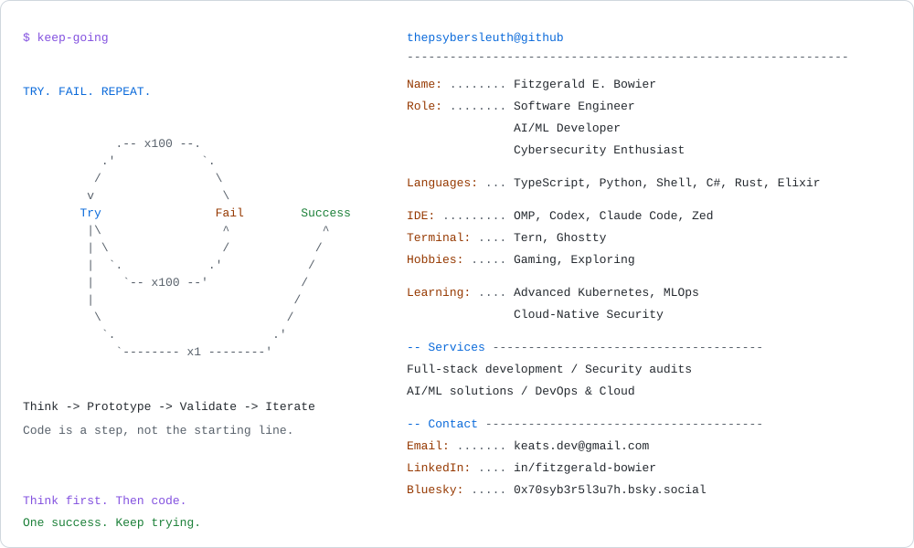

<picture>
  <source media="(prefers-color-scheme: dark)" srcset="./dark_mode.svg">
  <source media="(prefers-color-scheme: light)" srcset="./light_mode.svg">
  
</picture>

  <a href="https://www.linkedin.com/in/fitzgerald-bowier/">LinkedIn</a> ·
  <a href="mailto:keats.dev@gmail.com">Email</a> ·
  <a href="https://bsky.app/profile/0x70syb3r5l3u7h.bsky.social">Bluesky</a>

Plain-text profile

### Fitzgerald E. Bowier · ThePsyberSleuth

Software Engineer · AI/ML Developer · Cybersecurity Enthusiast

- **Programming languages:** TypeScript, Python, Shell, C#, Rust, Elixir.
- **IDE:** OMP, Codex, Claude Code, Zed.
- **Terminal:** Tern, Ghostty.
- **Hobbies:** Gaming, Exploring.
- **Learning:** Advanced Kubernetes, MLOps, and Cloud-Native Security.
- **Philosophy:** Think → Prototype → Validate → Iterate. Code is a step in the cycle, not the starting line.

**Open to collaboration:** full-stack development, security audits and penetration testing, AI/ML solutions, and DevOps / cloud strategy.

The best thing about a boolean is even if you're wrong, you are only off by a bit.

